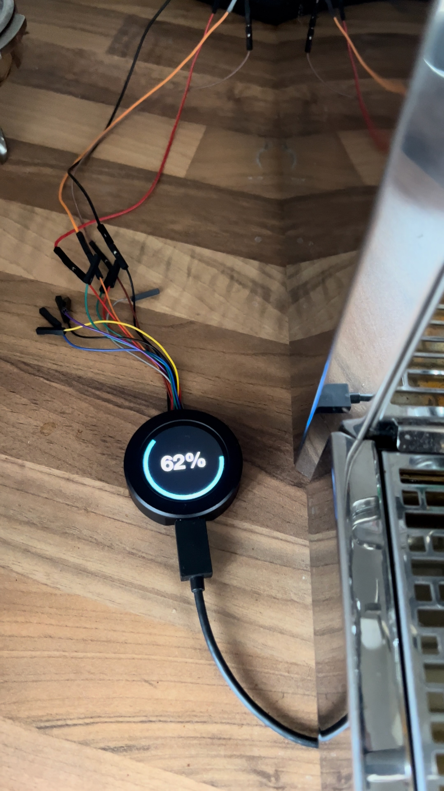
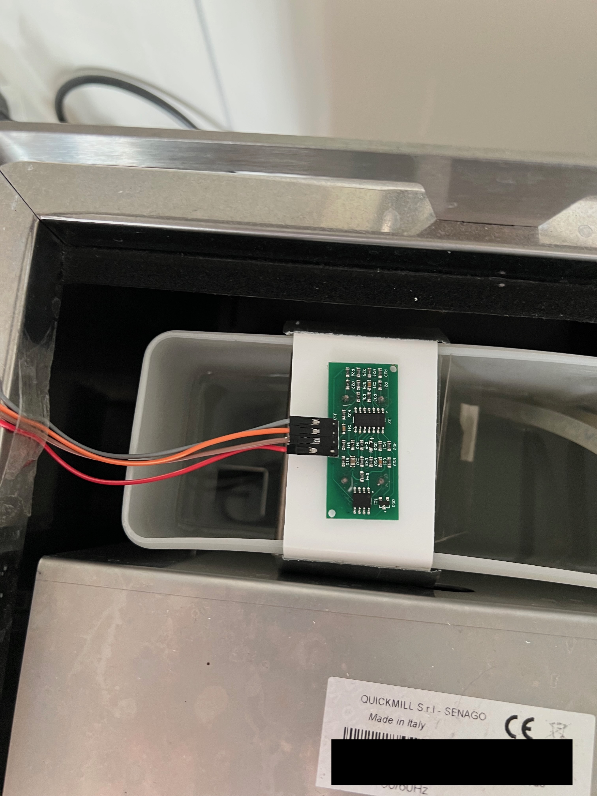
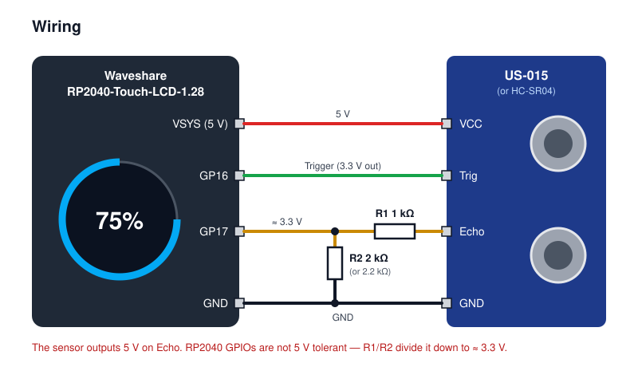
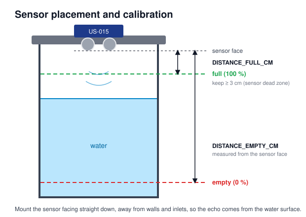

# Füllstandsanzeige für Espressomaschinen

[English](README.md) | **Deutsch**

Ein kleines Nachrüst-Projekt, das den Wasserstand im Tank einer Espressomaschine per Ultraschall misst und auf einem runden Touch-Display als farbigen Ring anzeigt.

Ursprünglich für eine **Quick Mill Rubino** gebaut, funktioniert es aber mit jeder Maschine, deren Wassertank von oben zugänglich ist. Du musst nur zwei Abstände für deinen Tank eintragen.

<p align="center">
  
  
</p>

## Funktionen

- Füllstand in Prozent mit farbigem Ring: **blau** (OK), **orange** (wird knapp), **rot** (jetzt nachfüllen)
- Wacht auf, wenn die Maschine bewegt wird oder vibriert (Pumpe, Hebel), oder wenn du auf das Display tippst
- Display schaltet sich nach 3 Minuten ohne Interaktion ab; gemessen wird im Hintergrund weiter
- Ausreißer-Filter für stabile Messwerte
- Kalibriermodus, der den gemessenen Abstand in cm auf dem Display anzeigt
- Alles in einer einzigen Datei einstellbar: [`config.py`](config.py)

## Hardware

| Bauteil | Hinweise |
|---------|----------|
| [Waveshare RP2040-Touch-LCD-1.28](https://www.waveshare.com/wiki/RP2040-Touch-LCD-1.28) | RP2040 mit rundem 1,28"-Display 240×240 (GC9A01), Touch (CST816) und Lagesensor (QMI8658) auf dem Board |
| Ultraschallsensor **US-015** (hier verbaut) oder **HC-SR04** | Gleiche Pinbelegung und gleiches Protokoll, Versorgung mit 5 V |
| 2 Widerstände: **1 kΩ** und **2 kΩ** (oder 2,2 kΩ) | Spannungsteiler für das Echo-Signal — **erforderlich**, siehe unten |
| Kabel, USB-C-Kabel / 5-V-Netzteil | |
| Halterung für den Sensor über der Tanköffnung | z. B. 3D-gedruckt oder aus gebogenem Kunststoff |

> **3,3-V-Alternative:** HC-SR04P- oder RCWL-1601-Module laufen mit 3,3 V. Diese an 3V3 statt VSYS anschließen und Echo direkt verbinden — dann ist kein Spannungsteiler nötig.

## Verdrahtung



| Sensor-Pin | Board-Pin | |
|------------|-----------|---|
| VCC | VSYS (5 V) | |
| Trig | GP16 | direkt |
| Echo | GP17 | **über Spannungsteiler**: Echo → 1 kΩ → GP17, und GP17 → 2 kΩ → GND |
| GND | GND | |

> [!WARNING]
> Mit 5 V versorgt gibt der Sensor am Echo-Pin ein **5-V-Signal** aus. Das Board selbst darf mit 5 V versorgt werden, die **GPIO-Eingänge des RP2040 vertragen aber nur 3,3 V und sind nicht 5-V-tolerant** (max. ≈ 3,6 V). Echo direkt anzuschließen scheint oft zu funktionieren, betreibt den Chip aber außerhalb seiner Spezifikation und kann ihn mit der Zeit beschädigen. Der Spannungsteiler aus 1 kΩ / 2 kΩ senkt das Signal auf ≈ 3,3 V.

Wenn du andere GPIOs verwendest, kannst du die Pins in [`config.py`](config.py) ändern.

## Installation

### 1. Firmware flashen

Der Display-Treiber ist ein natives Modul. Du brauchst deshalb eine **MicroPython-Firmware mit eingebautem `gc9a01`-Modul** — Standard-MicroPython reicht nicht.

1. Die fertige RP2-Firmware (`.uf2`) von [russhughes/gc9a01_mpy](https://github.com/russhughes/gc9a01_mpy) herunterladen (Ordner `firmware`).
2. Die **BOOT**-Taste gedrückt halten und dabei USB einstecken. Das Board erscheint als Laufwerk `RPI-RP2`.
3. Die `.uf2`-Datei auf dieses Laufwerk kopieren. Das Board startet neu mit MicroPython.

### 2. Code hochladen

Alle `.py`-Dateien aus diesem Repository auf das Board kopieren, z. B. mit [`mpremote`](https://docs.micropython.org/en/latest/reference/mpremote.html):

```sh
pip install mpremote
mpremote cp *.py :
mpremote reset
```

Alternativ mit [Thonny](https://thonny.org/) oder der VS-Code-Erweiterung [MicroPico](https://marketplace.visualstudio.com/items?itemName=paulober.pico-w-go) („Upload project to Pico“).

`main.py` startet automatisch beim Einschalten.

## Anpassung an deine Maschine



Der Füllstand wird aus zwei Abständen berechnet, beide gemessen von der **Vorderseite des Sensors** bis zur **Wasseroberfläche**:

| Einstellung | Bedeutung | Quick Mill Rubino |
|-------------|-----------|-------------------|
| `DISTANCE_FULL_CM` | Abstand bei vollem Tank (100 %) | `3` |
| `DISTANCE_EMPTY_CM` | Abstand bei leerem Tank (0 %) | `17` |

### Kalibrierung Schritt für Schritt

1. Den Sensor über der Tanköffnung montieren (z. B. mit einer Halterung quer über den Tank, siehe Foto oben), senkrecht nach unten ausgerichtet und mit freier Sicht aufs Wasser (Abstand zu Wänden, Schläuchen und dem Zulauf).
2. In [`config.py`](config.py) `CALIBRATION_MODE = True` setzen und den Code hochladen.
3. Das Display zeigt jetzt den gemessenen Abstand in cm an (z. B. `12.4`).
4. Den Tank bis zu deinem „voll“-Stand füllen → Wert als `DISTANCE_FULL_CM` notieren.
5. Bis zu dem Stand ablassen, bei dem 0 % angezeigt werden soll → Wert als `DISTANCE_EMPTY_CM` notieren. Tipp: etwas oberhalb des Punkts wählen, an dem die Pumpe Luft zieht.
6. Beide Werte eintragen, `CALIBRATION_MODE = False` setzen und erneut hochladen.

> Der Sensor kann nicht näher als etwa 2–3 cm messen. `DISTANCE_FULL_CM` sollte deshalb mindestens 3 cm betragen, z. B. indem du den Sensor etwas höher montierst.

### Weitere Einstellungen

Alle Optionen sind in [`config.py`](config.py) dokumentiert:

| Einstellung | Standard | Beschreibung |
|-------------|----------|--------------|
| `LEVEL_CRITICAL_PERCENT` / `LEVEL_LOW_PERCENT` | 10 / 25 | Schwellen für Rot / Orange |
| `COLOR_OK`, `COLOR_LOW`, `COLOR_CRITICAL` | blau, orange, rot | Ringfarben als RGB |
| `SCREEN_TIMEOUT_S` | 180 | Display aus nach Inaktivität; `0` = immer an |
| `READOUT_INTERVAL_ACTIVE_S` / `_INACTIVE_S` | 10 / 60 | Messintervall bei Display an / aus |
| `WAKE_ON_MOTION`, `WAKE_ON_TOUCH` | `True` | Aufwach-Quellen |
| `MOTION_THRESHOLD_G` | 0.25 | Bewegungsempfindlichkeit (kleiner = empfindlicher) |
| `DISPLAY_ROTATION` | 0 | Display in 90°-Schritten drehen |
| `DEBUG` | `False` | Ausführliche Log-Ausgabe auf der seriellen Konsole |

## Fehlerbehebung

| Problem | Lösung |
|---------|--------|
| Display bleibt nach dem Flashen schwarz | Prüfen, ob die Firmware **mit** `gc9a01` geflasht wurde (Schritt 1). Auf der seriellen Konsole nach `ImportError` schauen. |
| Füllstand springt oder zeigt 0 % | Verdrahtung und Spannungsteiler prüfen. Sicherstellen, dass der Sensor senkrecht auf die Wasseroberfläche zeigt. Mit `CALIBRATION_MODE` die Rohwerte ansehen. |
| `DISTANCE_FULL_CM ... must be smaller than DISTANCE_EMPTY_CM` | Die beiden Kalibrierwerte sind vertauscht. |
| Display wacht zu oft / gar nicht auf | `MOTION_THRESHOLD_G` und `MOTION_WINDOW_SAMPLES` anpassen. |
| „touch controller not detected“ auf der Konsole | Aufwecken per Touch wird automatisch deaktiviert, Bewegung funktioniert weiter. Board einmal stromlos machen. |

Für ausführliche Logs `DEBUG = True` setzen und die serielle Konsole öffnen (z. B. `mpremote repl`).

## Projektstruktur

| Datei | Zweck |
|-------|-------|
| [`config.py`](config.py) | **Alle Einstellungen** |
| [`main.py`](main.py) | Einstiegspunkt, Hauptschleife und Kalibriermodus |
| [`ultrasonic_sensor.py`](ultrasonic_sensor.py) | Abstandsmessung, Filterung, Umrechnung in Prozent |
| [`screen_driver.py`](screen_driver.py) | Display-Setup, Ring- und Textausgabe |
| [`colors.py`](colors.py) | Farben und Zuordnung Füllstand → Farbe |
| [`accelerometer.py`](accelerometer.py) | Treiber für den Lagesensor QMI8658 mit Bewegungserkennung |
| [`touch_engine.py`](touch_engine.py) | Treiber für den Touch-Controller CST816 |
| [`hcsr04.py`](hcsr04.py) | Treiber für den Ultraschallsensor (Fremdcode) |
| [`inter_bold_64.py`](inter_bold_64.py) | Bitmap-Schrift für das Display (generiert) |
| [`log.py`](log.py) | Debug- und Warnausgaben |

## Haftungsausschluss

Dies ist ein Hobbyprojekt. In Espressomaschinen kommen Wasser, Hitze und Netzspannung zusammen. Montiere den Sensor nur am Wassertank, niemals in der Nähe von Boiler, Heizelementen oder Netzverkabelung, und halte die gesamte Elektronik von Wasser und heißen Teilen fern. Ziehe vor allen Arbeiten den Netzstecker. Die Verwendung erfolgt auf eigene Gefahr; die Autoren übernehmen keine Haftung für Schäden an deiner Maschine oder anderswo.

Quick Mill und Rubino sind Marken ihres jeweiligen Inhabers. Dieses Projekt steht in keiner Verbindung zu Quick Mill und wird nicht von Quick Mill unterstützt.

## Lizenz

Der Code dieses Projekts steht unter der [MIT-Lizenz](LICENSE).

Fremdbestandteile (HC-SR04-Treiber, auf Waveshare-Code basierende Treiber, Schrift Inter) stehen unter ihren eigenen Lizenzen — siehe [THIRD_PARTY_NOTICES.md](THIRD_PARTY_NOTICES.md).

## Danksagung

- [rsc1975/micropython-hcsr04](https://github.com/rsc1975/micropython-hcsr04) — Treiber für den Ultraschallsensor
- [russhughes/gc9a01_mpy](https://github.com/russhughes/gc9a01_mpy) — GC9A01-Display-Treiber und Font-Konverter
- [Waveshare](https://www.waveshare.com/wiki/RP2040-Touch-LCD-1.28) — Beispielcode für Lagesensor und Touch-Controller
- [Inter](https://github.com/rsms/inter) von Rasmus Andersson — Schrift
