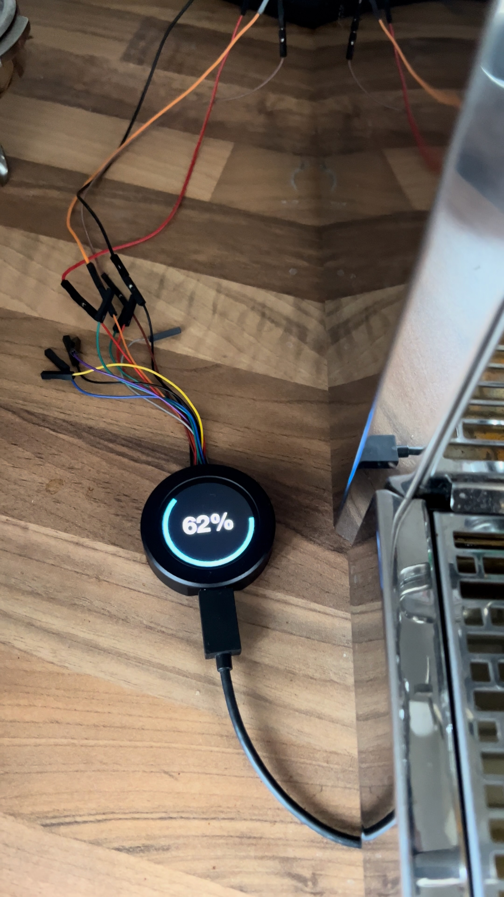
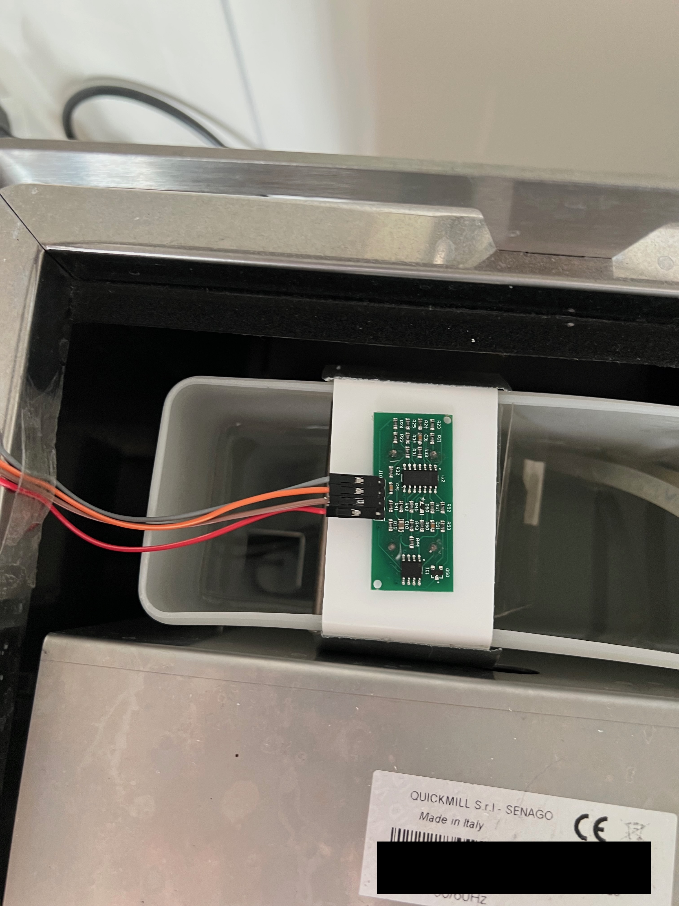
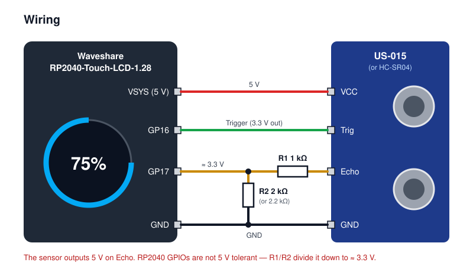
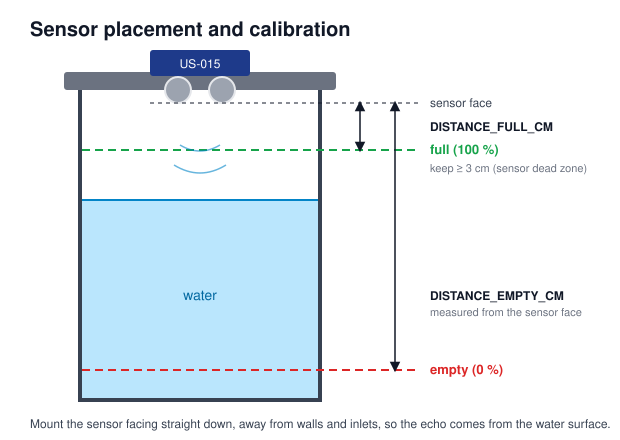

# Espresso Machine Water Level Indicator

**English** | [Deutsch](README.de.md)

A small add-on that measures the water level in the tank of an espresso machine with an ultrasonic sensor and shows it on a round touch display as a colored ring.

Originally built for a **Quick Mill Rubino**, but it works with any machine that has a top-loading water tank — you only need to enter two distances for your tank.

<p align="center">
  
  
</p>

## Features

- Fill level in percent with a colored ring: **blue** (OK), **orange** (low), **red** (refill now)
- Wakes up when the machine is moved or vibrates (pump, lever) or when you tap the display
- Screen turns off after 3 minutes without interaction; the level is still measured in the background
- Outlier filtering for stable readings
- Calibration mode that shows the raw distance in cm on the display
- Everything configurable in a single file: [`config.py`](config.py)

## Hardware

| Part | Notes |
|------|-------|
| [Waveshare RP2040-Touch-LCD-1.28](https://www.waveshare.com/wiki/RP2040-Touch-LCD-1.28) | RP2040 with 1.28" round 240×240 display (GC9A01), touch (CST816) and IMU (QMI8658) on board |
| Ultrasonic sensor **US-015** (used here) or **HC-SR04** | Same pinout and protocol, powered from 5 V |
| 2 resistors: **1 kΩ** and **2 kΩ** (or 2.2 kΩ) | Voltage divider for the Echo signal — **required**, see below |
| Wires, USB-C cable / 5 V supply | |
| Bracket to hold the sensor above the tank opening | e.g. 3D-printed or bent plastic |

> **3.3 V alternative:** HC-SR04P or RCWL-1601 modules run on 3.3 V. Power them from 3V3 instead of VSYS and connect Echo directly — no divider needed.

## Wiring



| Sensor pin | Board pin | |
|------------|-----------|---|
| VCC | VSYS (5 V) | |
| Trig | GP16 | direct |
| Echo | GP17 | **via voltage divider**: Echo → 1 kΩ → GP17, and GP17 → 2 kΩ → GND |
| GND | GND | |

> [!WARNING]
> Powered from 5 V, the sensor outputs a **5 V** signal on Echo. The board itself can be powered with 5 V, but the RP2040's **GPIO inputs are 3.3 V only and not 5 V tolerant** (max. ≈ 3.6 V). Connecting Echo directly often seems to work, but stresses the chip outside its specification and can damage it over time. The 1 kΩ / 2 kΩ divider brings the signal down to ≈ 3.3 V.

Pins can be changed in [`config.py`](config.py) if you use different GPIOs.

## Installation

### 1. Flash the firmware

The display driver is a native module, so you need a **MicroPython firmware with the `gc9a01` module built in** — standard MicroPython is not enough.

1. Download the prebuilt RP2 firmware (`.uf2`) from [russhughes/gc9a01_mpy](https://github.com/russhughes/gc9a01_mpy) (folder `firmware`).
2. Hold the **BOOT** button while plugging in USB. The board shows up as a drive named `RPI-RP2`.
3. Copy the `.uf2` file to that drive. The board reboots into MicroPython.

### 2. Upload the code

Copy all `.py` files from this repository to the board, e.g. with [`mpremote`](https://docs.micropython.org/en/latest/reference/mpremote.html):

```sh
pip install mpremote
mpremote cp *.py :
mpremote reset
```

Alternatively use [Thonny](https://thonny.org/) or the [MicroPico](https://marketplace.visualstudio.com/items?itemName=paulober.pico-w-go) VS Code extension ("Upload project to Pico").

`main.py` starts automatically on power-up.

## Adapting it to your machine



The level is calculated from two distances, both measured from the **front of the sensor** to the **water surface**:

| Setting | Meaning | Quick Mill Rubino |
|---------|---------|-------------------|
| `DISTANCE_FULL_CM` | distance when the tank is full (100 %) | `3` |
| `DISTANCE_EMPTY_CM` | distance when the tank is empty (0 %) | `17` |

### Calibration step by step

1. Mount the sensor above the tank opening (e.g. with a bracket across the tank, see photo above), facing straight down, with a clear path to the water (away from walls, hoses and the inlet).
2. In [`config.py`](config.py) set `CALIBRATION_MODE = True` and upload the code.
3. The display now shows the measured distance in cm (e.g. `12.4`).
4. Fill the tank to your "full" level → note the value as `DISTANCE_FULL_CM`.
5. Drain it to the level where you want to see 0 % → note the value as `DISTANCE_EMPTY_CM`. Tip: choose a level slightly above the point where the pump starts drawing air.
6. Enter both values, set `CALIBRATION_MODE = False` and upload again.

> The sensor cannot measure closer than about 2–3 cm. Keep `DISTANCE_FULL_CM` at 3 cm or more, e.g. by mounting the sensor a little higher.

### Other settings

All options are documented in [`config.py`](config.py):

| Setting | Default | Description |
|---------|---------|-------------|
| `LEVEL_CRITICAL_PERCENT` / `LEVEL_LOW_PERCENT` | 10 / 25 | Thresholds for red / orange |
| `COLOR_OK`, `COLOR_LOW`, `COLOR_CRITICAL` | blue, orange, red | Ring colors as RGB |
| `SCREEN_TIMEOUT_S` | 180 | Screen off after inactivity; `0` = always on |
| `READOUT_INTERVAL_ACTIVE_S` / `_INACTIVE_S` | 10 / 60 | Measurement interval with screen on / off |
| `WAKE_ON_MOTION`, `WAKE_ON_TOUCH` | `True` | Wake-up sources |
| `MOTION_THRESHOLD_G` | 0.25 | Motion sensitivity (lower = more sensitive) |
| `DISPLAY_ROTATION` | 0 | Rotate the display in 90° steps |
| `DEBUG` | `False` | Detailed log output on the serial console |

## Troubleshooting

| Problem | Solution |
|---------|----------|
| Display stays black after flashing | Make sure you flashed the firmware **with** `gc9a01` (step 1). Check the serial console for `ImportError`. |
| Level jumps or shows 0 % | Check the sensor wiring and the voltage divider. Make sure the sensor points straight at the water surface. Use `CALIBRATION_MODE` to see raw values. |
| `DISTANCE_FULL_CM ... must be smaller than DISTANCE_EMPTY_CM` | The two calibration values are swapped. |
| Screen wakes up too often / not at all | Adjust `MOTION_THRESHOLD_G` and `MOTION_WINDOW_SAMPLES`. |
| "touch controller not detected" on the console | Touch wake is disabled automatically; motion wake still works. Power-cycle the board. |

Set `DEBUG = True` and open the serial console (e.g. `mpremote repl`) for detailed logs.

## Project structure

| File | Purpose |
|------|---------|
| [`config.py`](config.py) | **All user settings** |
| [`main.py`](main.py) | Entry point, main loop and calibration mode |
| [`ultrasonic_sensor.py`](ultrasonic_sensor.py) | Distance measurement, filtering, conversion to percent |
| [`screen_driver.py`](screen_driver.py) | Display setup, ring and text drawing |
| [`colors.py`](colors.py) | Colors and level → color mapping |
| [`accelerometer.py`](accelerometer.py) | QMI8658 IMU driver with motion detection |
| [`touch_engine.py`](touch_engine.py) | CST816 touch driver |
| [`hcsr04.py`](hcsr04.py) | Ultrasonic sensor driver (third party) |
| [`inter_bold_64.py`](inter_bold_64.py) | Bitmap font for the display (generated) |
| [`log.py`](log.py) | Debug / warning output |

## Disclaimer

This is a hobby project. Espresso machines combine water, heat and mains voltage. Only mount the sensor at the water tank, never near the boiler, heating elements or mains wiring, and keep all electronics away from water and hot parts. Unplug the machine before working on it. You do this at your own risk; the authors accept no liability for damage to your machine or anything else.

Quick Mill and Rubino are trademarks of their respective owner. This project is not affiliated with or endorsed by Quick Mill.

## License

The code of this project is licensed under the [MIT License](LICENSE).

Third-party components (HC-SR04 driver, Waveshare-based drivers, Inter font) are under their own licenses — see [THIRD_PARTY_NOTICES.md](THIRD_PARTY_NOTICES.md).

## Credits

- [rsc1975/micropython-hcsr04](https://github.com/rsc1975/micropython-hcsr04) — ultrasonic sensor driver
- [russhughes/gc9a01_mpy](https://github.com/russhughes/gc9a01_mpy) — GC9A01 display driver and font converter
- [Waveshare](https://www.waveshare.com/wiki/RP2040-Touch-LCD-1.28) — demo code for the IMU and touch controller
- [Inter](https://github.com/rsms/inter) by Rasmus Andersson — typeface
